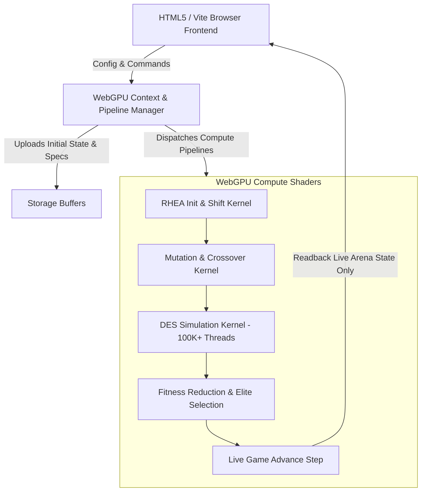

# WebGPU N vs N RHEA Discrete Event Combat Simulator

## Current execution path (2026-10-29)

The authoritative combat engine is `advance_combat` in `src/shaders/sim.wgsl.ts`.
`simulate_candidate` clones the GPU arena **and pending event heap**, constructs a candidate/opposing-elite plan, and calls this function for a prediction. `advance_live` calls the same function with both teams' extracted immediate actions, then writes the arena and heap back to GPU storage.

Live combat, planning, and presentation have independent schedules. The browser submits due 50 ms live steps first, then at most one short RHEA search batch per frame. A generation retains the full 32,768-candidate population, but evaluates it in batches (initially 2,048, adapting toward an 8 ms queue budget with bounds of 128–4,096). Only one search batch is in flight, preventing a long search backlog ahead of live work. WebGPU's ordered queue still serializes actual GPU commands; this is interleaving, not GPU preemption or a second compute queue.

Each generation copies the authoritative arena and pending heap into immutable search buffers and aligns the previous plan to that snapshot. Mutation and rollouts bind these copies, while `advance_live` binds separate authoritative state, heap, and committed-plan buffers. Reduction/extraction runs after every candidate has been evaluated. The completed plan and its snapshot metadata are published directly via GPU copies; telemetry readback does not gate publication or live stepping.

Each entity persists a decision counter. Committed metadata stores the snapshot time and original decision counts. Live stepping skips plan actions corresponding to decisions already consumed while search was in flight and validates affordability, ownership, target relationship, and range at execution. The UI preview uses the same consumed-decision offset. Individual spell cooldown state remains unimplemented.

Rendering uses two non-blocking staging slots for the 2,224-byte arena and bounded event ring. If both are busy, a render snapshot is skipped without skipping combat. Sequence and epoch checks reject out-of-order and pre-reset snapshots. GPU combat events use a cumulative 80-entry ring; the host deduplicates overlapping reads. Explicit editor uploads pause scheduling and fetch the latest GPU state before applying configuration changes. Search time, batch time/size, plan origin, and submitted live time are included in exported battle reports.

The heap retains cast completions, periodic ticks, swing timers, and decision events across live commits. Decisions move units in 500 ms increments on the GPU; the renderer performs client-side dead reckoning and directional extrapolation to present smooth motion. Both paths currently retain simplified spell mechanics: individual cooldowns, proper periodic-aura refresh/dispel ownership, and pillar LoS still need work. Sharing the engine guarantees a common implementation, not complete spell fidelity or identical plans for independently optimized opponents.

`diagnostics/combat-parity.html` checks fixed-plan predictions against repeated 50 ms commitments, including re-prediction from midfight state, delayed-plan decision offsets, and resource revalidation. `npm test` exercises host scheduling with deliberately delayed fake GPU fences/readbacks; it does not simulate combat. Browser runtime verification is still required; native compilation alone does not prove runtime parity.

The sections below include design targets and illustrative structs, **not an exact description of every implemented mechanic or buffer layout**. Use the shader source and TODO audit for current details.

## 1. Executive Summary & Goals

This project implements a high-throughput, GPU-native discrete event simulation (DES) and Rolling Horizon Evolutionary Algorithm (RHEA) real-time planner running in the browser via **WebGPU (Compute Shaders in WGSL)**.
Inspired by:
- **`~/fastsim`**: GPU-accelerated event-driven combat simulation (achieving ~1.6M fights/second using Vulkan compute shaders with fixed 40-event binary heaps per invocation).
- **`~/pvp_sim`**: Real-time PvP decision making, simultaneous action spaces, stats/talents/mitigation mechanics, and combat analysis.

### Core Distinctions & Innovations
1. **GPU Only (Zero CPU Combat Loop)**:
   - State representation, priority queues (DES event heaps), entity updates, damage formulas, mitigating stats, RNG generation, mutation, rollout evaluation, and action selection run entirely in WebGPU compute pipelines.
   - The CPU / JavaScript layer is strictly an orchestrator and visualizer (rendering Canvas / WebGPU scene, dispatching compute passes, and inspecting results).
2. **Unified Universal Entity Mechanics (Homogeneous Engine)**:
   - Instead of fragmented or asymmetric class-specific logic branches that break warp efficiency or induce divergent swing-timer mechanics, all entities conform to a **single universal entity structure**.
   - Universal rules dictate swing timers, global cooldowns (GCD), casting/channeling states, aura/buff/debuff slot arrays, and resource ticks. Differences across specs/classes are parameterized as numerical attributes and spell definition data tables.
3. **N vs N Multi-Agent Simultaneous RHEA**:
   - Rolling Horizon Evolutionary Algorithm (RHEA) plans action sequences over a forward horizon (e.g., $H=10$ to $20$ decision steps / $5$ to $15$ seconds).
   - In an $N$ vs $N$ matchup (e.g., 2v2, 3v3, or 5v5), each agent evolves a sequence of candidate actions.
   - GPU workgroups concurrently evaluate hundreds of thousands of candidate trajectory mutations against current opponent trajectories using the WebGPU DES kernel.
4. **Interactive Browser GUI**:
   - A clean browser interface with a "Search & Act" button.
   - Real-time visualization of unit frames, HP/resource bars, swing timers, cast bars, aura stacks, and combat log / action decisions as the RHEA planner iterates.

---

## 2. Universal Entity Model (Unified Mechanics)

To ensure memory coherence, zero warp divergence in WebGPU, and 100% mechanical consistency, every combatant shares the exact same struct layout in WGSL storage buffers.

### WGSL Universal Entity State (`EntityState`)
```wgsl
struct EntityState {
    // Identity & Team
    id: u32,               // 0 to 2N - 1
    team: u32,             // 0 or 1
    alive: u32,            // 1 = alive, 0 = dead
    target_id: u32,        // current primary target index

    // Resources & Vitals
    hp: f32,
    max_hp: f32,
    power: f32,            // Mana, Rage, or Energy
    max_power: f32,
    power_type: u32,       // 0 = Mana, 1 = Rage, 2 = Energy

    // Combat Timers & Mechanics (Shared Across All Entities)
    gcd_end: u32,          // Timestamp (in ms) when GCD finishes
    cast_end: u32,         // Timestamp when current spellcast completes
    cast_spell_id: u32,    // Spell currently being cast
    channel_end: u32,      // Timestamp when channel ends
    swing_timer: u32,      // Timestamp when next auto-attack swings
    swing_speed_ms: u32,   // Main-hand swing interval in ms (e.g., 2000ms, 2600ms, 3300ms)
    range_attack_timer: u32, // Off-hand or ranged timer

    // Combat Stats
    attack_power: f32,
    spell_power: f32,
    crit_chance: f32,      // 0.0 to 1.0
    hit_chance: f32,       // 0.0 to 1.0
    armor: f32,
    magic_resists: vec4<f32>, // Fire, Frost, Shadow, Nature

    // Positioning (2D Arena Coordinates in float yards)
    pos: vec2<f32>,
    facing: f32,
    move_speed: f32,       // yards per second

    // Active Auras (Fixed capacity for cache locality)
    // 8 Buffs + 8 Debuffs per entity
    auras: array<AuraSlot, 16>,
};

struct AuraSlot {
    spell_id: u32,
    stacks: u32,
    expires_at: u32,       // ms
    tick_interval_ms: u32,
    next_tick_at: u32,     // ms
    value: f32,            // dot damage or buff modifier
};
```

### Why Universal Mechanics Work
- **Swing Timers**: Every entity has a `swing_timer` and `swing_speed_ms`. Even casters have an auto-attack timer (wand/staff melee), and melee classes have their weapon speed passed in. If a unit is casting a spell, their swing timer pauses or continues per universal rules.
- **Resource Regens**: Evaluated periodically via universal tick events or timestamps.
- **Spells**: Spells are data-driven indexes into a constant/uniform table defining:
  - `cast_time_ms`, `cooldown_ms`, `cost`, `school`, `range_min`, `range_max`, `effect_type` (DirectDamage, Heal, Buff, DoT, Stun).

---

## 3. High-Throughput WebGPU Discrete Event Simulator (DES)

### Lessons from `fastsim`
In `~/fastsim`, simulation throughput (~1.56M fights/s) is achieved because:
1. Each GPU thread simulates an independent combat trajectory.
2. An in-place fixed-size binary heap (40 events) is stored directly in thread-private memory (or local register storage).
3. Heap operations (`enqueue`, `dequeue`, `sift-up`, `sift-down`) avoid pointer chasing and use flat integer arrays.
4. Timestamps are integers (milliseconds), eliminating floating-point rounding quirks.

### DES Architecture in WebGPU WGSL
```wgsl
struct Event {
    at: u32,               // Execution timestamp in ms
    kind: u32,             // EV_SWING, EV_CAST_COMPLETE, EV_DOT_TICK, EV_GCD, EV_RHEA_STEP
    source_id: u32,        // Entity initiating
    target_id: u32,        // Entity targeted
    spell_id: u32,         // Associated spell/action ID
    generation: u32,       // Invalidation / dispel / cancellation token
};

// Fixed-size binary min-heap per simulation thread
struct SimQueue {
    size: u32,
    events: array<Event, 40>,
};
```

### Simulation Loop
Each thread executes:
```wgsl
while (queue.size > 0u && now < max_sim_time_ms && !match_over) {
    let ev = dequeue(&queue);
    now = ev.at;
    process_event(ev, &sim_state, &queue);
}
```

---

## 4. Rolling Horizon Evolutionary Algorithm (RHEA) for N vs N

### What is RHEA?
Rather than a deep MCTS tree which suffers from immense branching factors in continuous simultaneous multi-agent combat ($K^N$ joint actions), **RHEA** maintains an individual candidate plan represented as a chromosome:
$$\text{Plan}_i = [a_{i,0}, a_{i,1}, a_{i,2}, \dots, a_{i,H-1}]$$
where $a_{i,t} \in \mathcal{A}_i$ is the action chosen by entity $i$ at decision step $t$ across horizon $H$.

In an $N$ vs $N$ match, the joint population evaluates candidates:
- **Joint Plan**: A matrix of actions for all $2N$ combatants across horizon $H$.
- **Evolutionary Loop on GPU**:
  1. **Population Initialization**: Seed with greedy policies, previous frame's shifted best plan, or random valid actions.
  2. **Mutation**: Mutate $1 \dots 3$ actions per individual with domain-aware exploration.
  3. **Parallel Rollout**: Concurrently dispatch $P$ workgroups (e.g. 1024 or 4096 candidate mutations). Each lane runs the DES simulation forward $T$ seconds.
  4. **Fitness Evaluation**:
     $$\text{Fitness}(\text{Team 0}) = \sum_{u \in \text{Team 0}} (\text{HP}_u + \text{Resource}_u) - \sum_{v \in \text{Team 1}} (\text{HP}_v \times 2.0) + \text{DamageDealt} - \text{DamageTaken}$$
  5. **Selection**: Elite preservation + next generation.
  6. **Action Commitment**: The first action $a_{0}$ of the elite plan is executed in the live game state.

---

## 5. System Architecture & Tech Stack



### Frontend / UI Features
- **Zero Heavy Dependencies**: Pure TypeScript + Vite + raw WebGPU (via WGSL shaders).
- **Control Bar**:
  - `[ Search & Act ]` toggle button to enable continuous real-time GPU RHEA search and execution.
  - `[ Step Frame ]` for manual deterministic stepping.
  - `[ Reset Match ]` with team composition pickers (e.g., 2v2: Warrior + Priest vs Mage + Warlock).
- **Live Arena Visualization**:
  - Real-time 2D canvas displaying fighter positions, ranges, target lines, cast bars, swing progress, and floating numbers.
  - RHEA telemetry: Millions of simulations/sec, search horizon, elite candidate fitness trajectories.
